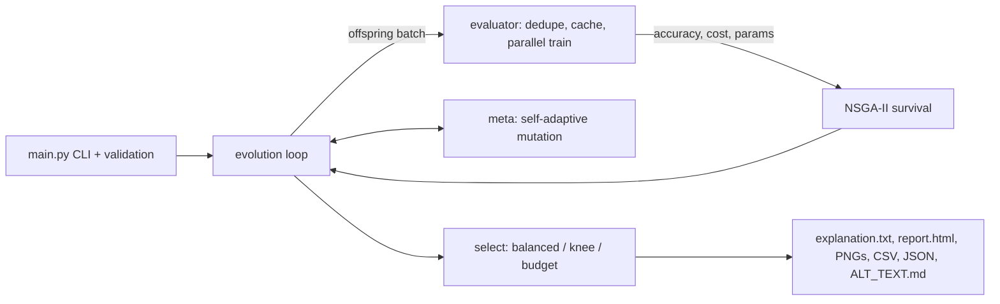

# AutoMind-X
**Self-Adaptive Explainable Neural Architecture Search with Meta-Evolutionary Optimization** - pure Python.

AutoMind-X evolves small neural networks and trades off **accuracy, training cost and model size at the
same time** (NSGA-II Pareto search), adapts its own mutation rate while it runs, and finishes with a
plain-language report explaining *why* the winning architecture was chosen.

## Problem statement
Choosing a neural-network architecture is a three-way trade-off - accuracy, training cost and model size - yet most
AutoML tools return a single opaque "best" model. Teams that must deploy under a size or latency budget cannot see
*why* a model was picked or what they gave up.

## Solution
AutoMind-X searches architectures with a multi-objective evolutionary algorithm (NSGA-II), lets the search adapt its own
mutation rate, honours deployment budgets, and ends with a plain-language, verifiable explanation plus accessible reports.

## Scope, configuration and services
* **Type:** Python command-line application. There is **no frontend, backend server, database, authentication or external AI/API**;
  all data is synthetic (scikit-learn `make_classification`) and generated locally. No network calls are made.
* **Environment variables / secrets:** none required. **Database setup:** none.
* **"API" overview:** the public interface is the CLI (table below) and the `automind` Python package (`Config`, `AutoMindX`, `select_final`, `explain`).
* **AI/ML configuration:** every knob is in `automind/config.py` (`Config`); the CLI exposes the important ones.

## Quick start
```bash
pip install -r requirements.txt
python main.py --quick                 # ~5-10 s demo
python main.py                         # full run: 4 graphs + report + CSV in outputs/
python main.py --select knee --json    # weight-free "best compromise" pick + summary.json
python main.py --help                  # every option
pip install -r requirements-dev.txt && make check   # lint + types + security scan + tests: 75 tests, ~99% coverage
```

| Option | Meaning |
|---|---|
| `--quick` | small fast demo |
| `--generations N`, `--pop N`, `--seed N` | search size and reproducibility |
| `--runtime-metric {proxy,wallclock}` | `proxy` (default) = deterministic FLOPs-based cost, fully reproducible; `wallclock` = measured seconds |
| `--select {balanced,knee}` | final choice: weighted fitness, or the knee point (closest to the ideal point, no weights) |
| `--n-jobs N` | parallel training of each generation's offspring (`-1` = all cores, `1` = serial) |
| `--max-params N`, `--max-cost X` | deployment budget: the chosen model must fit; the report says whether it was satisfiable |
| `--json`, `--no-plots`, `--quiet` | machine-readable summary, skip figures, silence progress |

Exit codes: `0` success, `1` output could not be written, `2` invalid input, `130` interrupted. Invalid values (seed outside 0..2^32-1, non-finite budgets, absurd sizes) are rejected with a clear message.

## What is new in this version
* **Fully reproducible runs** - a deterministic FLOPs-based runtime proxy replaces noisy wall-clock time (wall-clock still recorded and selectable); same seed => identical search, verified by a test.
* **Faster** - vectorised dominance sort, memoised baseline/hold-out training, and each generation's offspring are deduplicated and trained as one parallel batch (joblib), with graceful serial fallback.
* **Budget-aware selection** - "give me the best model under N parameters" (`--max-params`, `--max-cost`), with an honest message when the budget is impossible.
* **Accessible `report.html`** - semantic landmarks, skip link, alt text, captioned tables, no JavaScript, escaped text.
* **Knee-point selection** - a weight-free way to pick the best compromise on the Pareto front.
* **Validated config and CLI** - bad input fails fast with a clear message.
* **Accessible outputs** - colour-blind-safe palette, marker/line-style redundancy, and `ALT_TEXT.md` text descriptions of every figure.
* **Engineering hygiene** - 75 tests incl. property-based (Hypothesis), ruff + mypy + bandit clean, CI, Dockerfile, LICENSE, `SECURITY.md`, `CONTRIBUTING.md`, `CHANGELOG.md`, logging instead of prints.

## Architecture


## Folder structure
```
automind_x/
├── main.py                 entry point (CLI)
├── requirements.txt / requirements-dev.txt
├── pytest.ini, SECURITY.md, .gitignore, .github/workflows/ci.yml
├── automind/
│   ├── config.py           every hyper-parameter in one dataclass
│   ├── genome.py           Genome = layers + activation + lr + its OWN mutation-rate gene
│   ├── dataset.py          sklearn make_classification, train/val/test split
│   ├── evaluator.py        trains MLPs (batched, parallel, cached) -> accuracy, runtime, #params; hold-out test
│   ├── pareto.py           dominance, non-dominated sort, crowding, NSGA-II survival, hypervolume
│   ├── operators.py        tournament selection, crossover, 5 mutation operators
│   ├── meta.py             self-adaptive mutation + meta-evolution controller
│   ├── evolution.py        the evolution loop
│   ├── explain.py          "why was this selected?" report + hold-out check vs baseline
│   ├── report.py           accessible HTML report
│   └── visualize.py        convergence / fitness / accuracy-vs-runtime / Pareto plots
├── tests/                  test_core.py (units), test_extra.py (config, determinism, CLI, outputs)
├── benchmarks/bench.py     serial vs parallel + sort micro-benchmark
├── pyproject.toml, Makefile, Dockerfile, LICENSE, CHANGELOG.md, CONTRIBUTING.md
└── outputs/                generated graphs + report
```

## Implementation plan (build order)
1. **Search space** (`genome.py`, `config.py`): 1-4 hidden layers, sizes 4..128, 3 activations, 4 learning rates.
2. **Data + evaluator**: synthetic data; train each candidate; measure accuracy (validation), runtime, params.
3. **Multi-objective core** (`pareto.py`): NSGA-II ranking so we never collapse 3 goals into one number.
4. **GA operators**: selection, crossover, mutation.
5. **Meta layer**: evolve mutation rate + adapt it from population improvement.
6. **Evolution loop**, then **explainability**, then **plots**, then **tests**.

## Pseudocode
```
pop = random genomes; evaluate; NSGA-II rank + crowding
meta.update(best fitness)
repeat for each generation:
    offspring = []
    while |offspring| < N:
        p1, p2 = tournament(pop), tournament(pop)          # SELECTION (rank, then crowding)
        child  = crossover(p1, p2)  or  copy(p1)           # CROSSOVER
        child.rate = child.rate * exp(tau * N(0,1))        # META (individual): evolve own rate
        rate = clip(child.rate * meta.multiplier)          # META (population): global multiplier
        mutate(child, rate)                                # MUTATION: resize/add/remove/activation/lr
        evaluate(child)                                    # FITNESS: acc, runtime, params
    pool = unique(pop + offspring)
    pop  = NSGA-II survival(pool, N)  (+ keep the best-fitness champion)
    if best fitness improved: multiplier *= 0.85   (exploit)
    else:                     multiplier *= 1.25   (explore)   # META update
final = best balanced-fitness member of Pareto front 0
explain(final)  ->  vs alternatives, vs earlier generations, lineage, what the search learned
```

## How the 3 objectives + self-adaptation work
* **Selection uses Pareto dominance** (error, runtime, params all minimised) — no hand-tuned weights during search.
* **Scalar fitness** `0.6*acc - 0.2*time/time_ref - 0.2*params/params_ref` is used only to (a) sense improvement for the
  mutation controller, (b) plot the fitness graph, (c) pick ONE model from the final Pareto front.
* **Meta-evolution** = two levels: each genome carries and evolves its own mutation rate; a population multiplier
  goes up when progress stalls and down when it improves.

## Testing strategy
| Layer | What is checked |
|---|---|
| Unit | dominance, sorting, crowding, survival, hypervolume (analytic value 0.125 for point (.5,.5,.5)) |
| Property | 300 random crossover+mutation runs always yield valid genomes, >=1 operator applied |
| Correctness | analytic `count_params` == sklearn's real weight count |
| Behaviour | fitness ordering; cache hit; meta multiplier rises on stagnation, falls on improvement, stays bounded |
| Integration | tiny end-to-end run: history length, best fitness never decreases (elitism), report generated |
| Reproducibility | same seed -> identical whole run (best-fitness history and archive) |
| Robustness | invalid config / CLI args rejected; parallel == serial results; batch dedup |
| Outputs | CLI end-to-end writes report, CSV, JSON, 4 PNGs, alt text |

## Evaluation metrics
* Accuracy (validation during search, **test split** for the final honest number)
* Training time and parameter count of the chosen model
* Hypervolume of the front (Pareto quality, higher is better) — see convergence graph
* Front size, mean/best/worst fitness per generation
* Comparison with a default MLP(100) baseline (accuracy / time / params)
* Adaptation trace: mutation-rate gene + multiplier per generation

## Honest evaluation notes
* **Evolution vs random search** (`python benchmarks/vs_random.py 1 2 3`, equal budget of ~182 trained networks, hypervolume of the found front): evolution 0.770 / 0.753 / 0.745 vs random 0.725 / 0.754 / 0.744. It clearly won on 1 of 3 seeds and tied on the others, so with this small search space and budget the advantage over random search is **not demonstrated**; the value of the project is the multi-objective handling, budgets, and explanations.
* **Accuracy trade-off**: the selected model is ~12x smaller than the default MLP(100) baseline at ~2 points lower hold-out accuracy (see `outputs/explanation.txt`).
* **Meta-controller**: with only 12 generations the stagnation signal dominates, so the population multiplier usually reaches its 2.5 cap; the adaptation is visible but coarse.

## Known limitations (be upfront in your demo)
* Parallel speed-up depends on core count; it was only exercised for correctness on a single-core machine (`benchmarks/bench.py` reports your numbers).
* The default runtime objective is a FLOPs *proxy* (reproducible, hardware independent), not measured time; use `--runtime-metric wallclock` for real timings (evaluated serially to avoid CPU contention, so it is slower and not bit-reproducible).
* Small CPU MLPs from scikit-learn; the same loop works with PyTorch models by swapping `_train_and_score` in `evaluator.py`.
* Search space is a plain MLP; extending genes (dropout, batch size, skip connections) means adding a gene + a mutation op.

## Screenshots
Generated by `python main.py` into `outputs/` (text alternatives in `outputs/ALT_TEXT.md`):
`outputs/convergence.png`, `outputs/fitness.png`, `outputs/accuracy_vs_runtime.png`, `outputs/pareto_front.png`, and the accessible `outputs/report.html`.

## Future improvements
* Real datasets and a PyTorch back-end (swap `_train_and_score`); more genes (dropout, batch size, skip connections).
* Stronger search (surrogate-assisted pre-screening) - see the random-search comparison above.
* Measured-latency objective on target hardware.

## Team
Add your team / contributor names here before submission (not filled in: none were provided).
